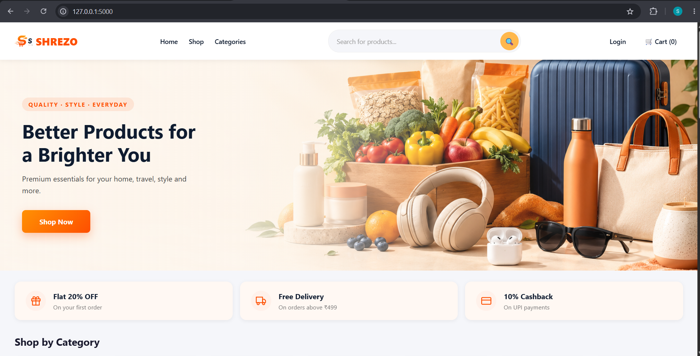
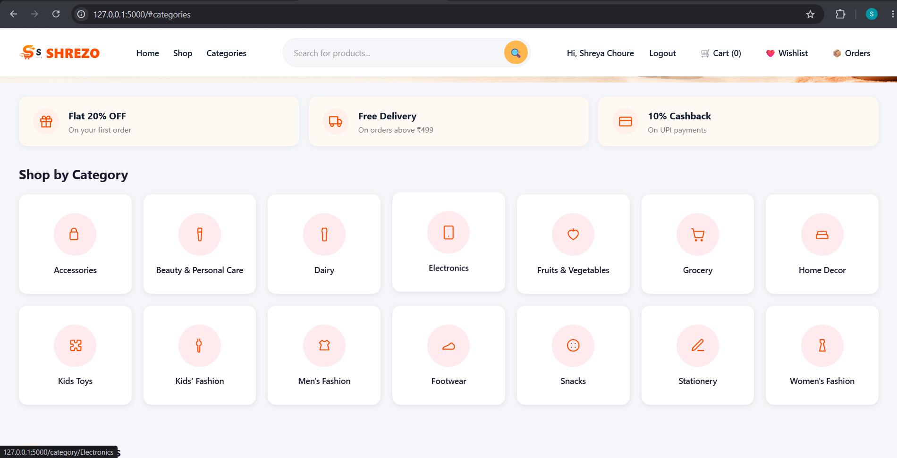
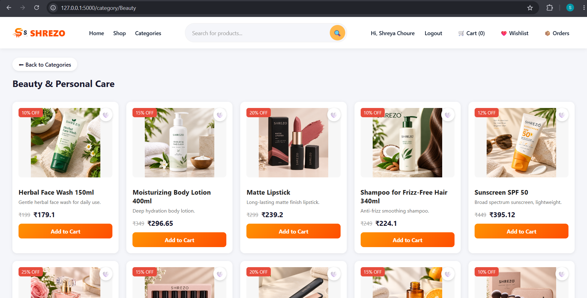
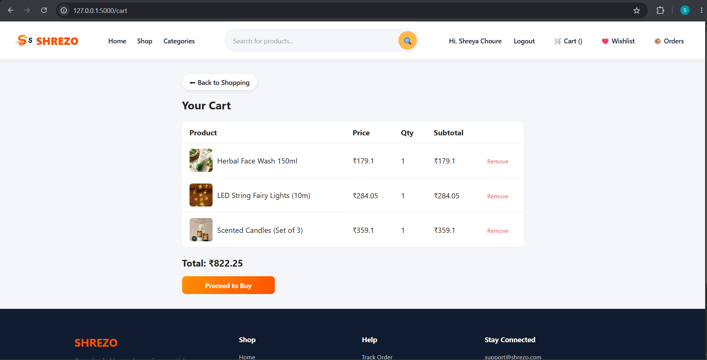
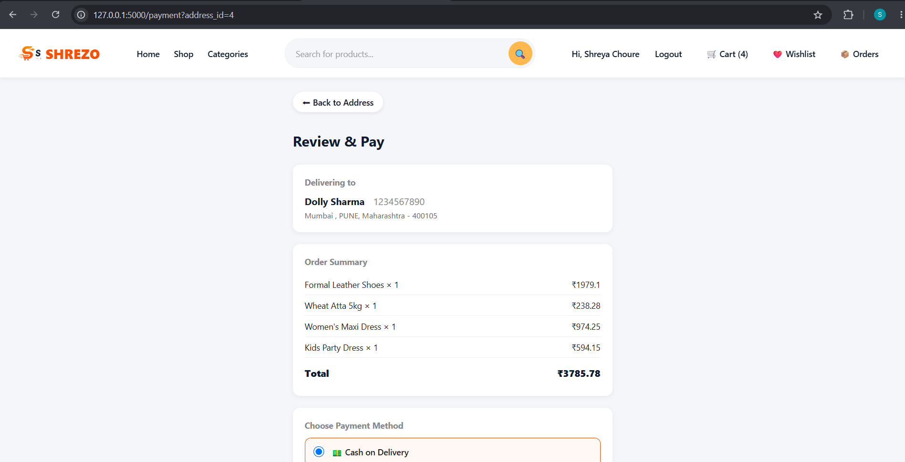
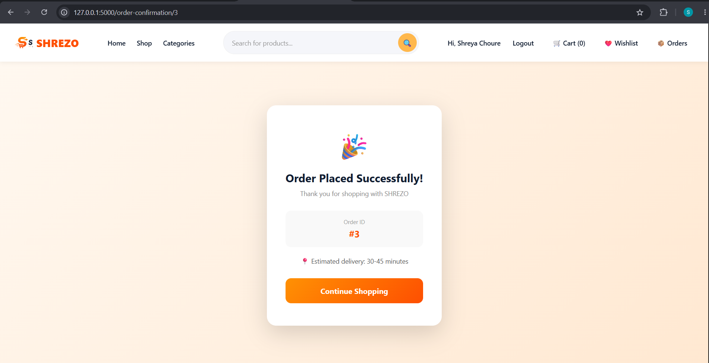
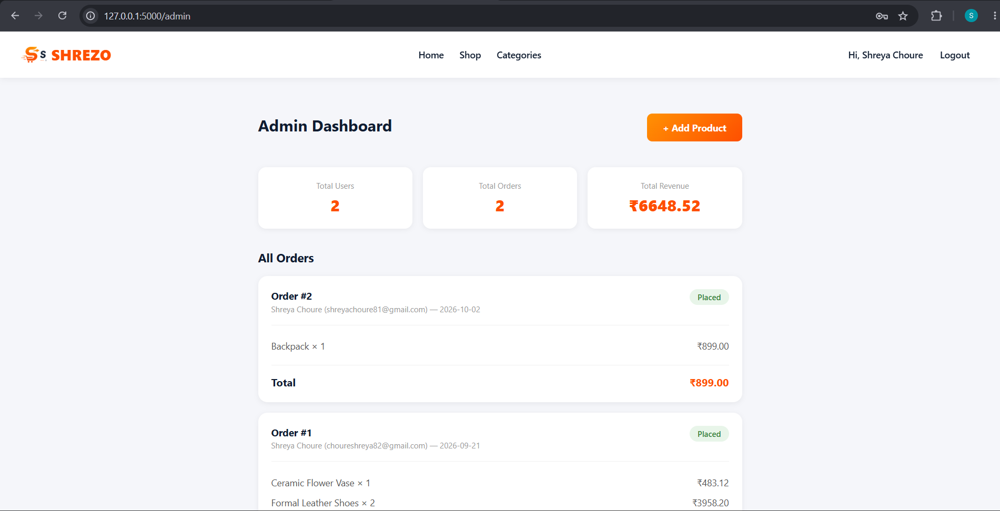

# SHREZO - E-commerce Web App

A full-stack e-commerce web application with 14 categories and 140+ products, built as a learning project.

## Features
- User signup, login, logout and password reset
- Product listing, search and product detail pages with image galleries
- Cart with quantity controls and wishlist
- Checkout flow with address, payment simulation and order confirmation
- Order history and admin dashboard

## Tech Stack
- **Frontend:** HTML, CSS, JavaScript
- **Backend:** Python (Flask), Jinja2
- **Database:** MySQL

## Screenshots

### Home

### Category

### Product Details

### Cart

### Checkout

### Order Confirmation

### Admin Dashboard

## How to Run
1. Clone the repository: `git clone https://github.com/Shreyachoure6/shrezo.git`
2. Go into the folder: `cd shrezo`
3. Install packages: `pip install -r requirements.txt`
4. Create a `db.py` file with your MySQL connection details
5. Run the app: `python app.py`
6. Open `http://127.0.0.1:5000` in your browser

## Author
Shreya Choure